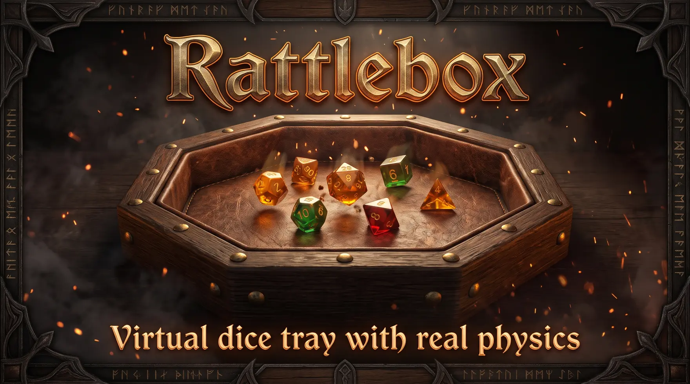
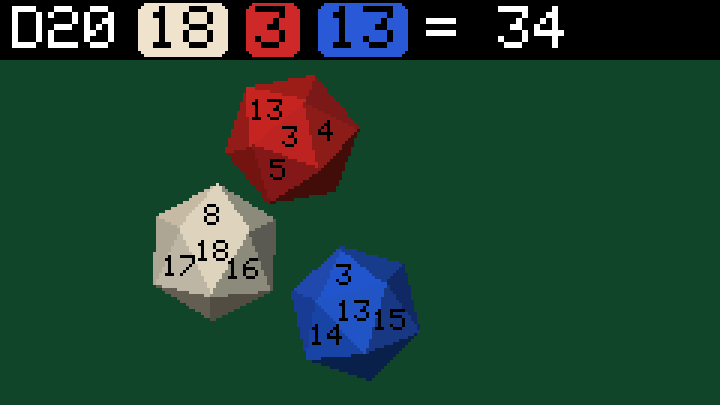
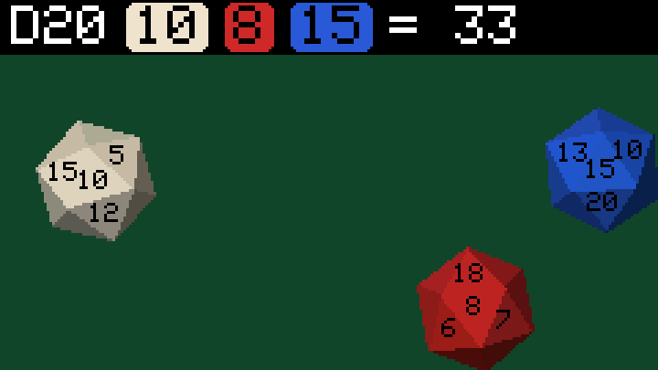

# Rattlebox

<p align="center">
  
</p>

<p align="center">
  <strong>A dice tray that fits in your hand: shake the device and the dice inside it roll</strong>
</p>

<p align="center">
  <a href="LICENSE"></a>
  
  
  
  <a href="https://www.npmjs.com/package/@isonimus/stele"></a>
</p>

<p align="center">
  <a href="#how-it-plays">How it plays</a> •
  <a href="#controls">Controls</a> •
  <a href="#supported-boards">Boards</a> •
  <a href="#building-and-flashing">Building</a> •
  <a href="#verifying">Verifying</a> •
  <a href="#roadmap">Roadmap</a> •
  <a href="#built-with-stele">Method</a>
</p>

Firmware for the M5Stack Cardputer ADV and the M5StickC Plus 2 in which 3D dice tumble inside
the device, driven by its accelerometer. Shake it and they clatter against the walls and each
other; tilt it and they slide; let them settle and the face each one lies on is its result.

<table>
  <tr>
    <td width="33%" align="center"><br><sub><b>Three D20</b> on the Cardputer ADV</sub></td>
    <td width="33%" align="center"><br><sub><b>Three D6</b> on the Cardputer ADV</sub></td>
    <td width="33%" align="center"><br><sub><b>Three D20</b> on the M5StickC Plus 2</sub></td>
  </tr>
</table>

> [!NOTE]
> Rattlebox is working toward its first version, v0.1. Everything below runs on both boards today,
> but there is no release yet: you build and flash it from source.

## How it plays

- **Shake to roll.** A shake throws every die and spins it to a random orientation drawn from the
  chip's hardware random number generator, so the result does not depend on the face it showed
  before (ADR-0010). A shake is told from handling the device by how long the motion lasts, not
  how hard it is (ADR-0005).
- **Tilt to slide.** The device's own motion is the tray's gravity, so tipping it slides the dice
  toward the low side.
- **Hold it at any angle.** People hold the device tilted toward their face, so the angle it is
  held still at counts as level. While dice are in flight, level follows your hand; once they
  lock, it changes only when you hold the device still again (ADR-0014).
- **Fair results.** A die's result locks the first time it comes to rest lying flat, and never
  changes until the next roll; a die propped on a wall or another die is nudged until it lies flat
  (ADR-0009). Each die type ships only after a fairness test over tens of thousands of simulated
  rolls through the same physics code passes (ADR-0002).
- **Readable results.** A strip above the tray shows the die type; once every die locks, it adds
  each die's result in that die's colour, and the total (ADR-0016).
- **Sound.** Every hit in the physics clacks: filtered noise through the Cardputer's speaker, a
  click on the StickC's buzzer. A shake's rattle is those same hits.

D6 and D20 are available, one to three dice of a type per roll. The device boots with one D20.

## Controls

| What it does | Cardputer ADV | M5StickC Plus 2 |
|---|---|---|
| Roll | Shake the device | Shake the device |
| Switch between D6 and D20 | `Enter` | Button A (front) |
| Cycle one, two, three dice | `Backspace` | Button B (side) |
| One die more / one fewer | `;` (up) / `.` (down) | |

Changing the dice throws the new set at once.

## Supported boards

| Board | Chip | Display | Sound | Motion sensor |
|---|---|---|---|---|
| M5Stack Cardputer ADV | ESP32-S3 | 240 × 135 | ES8311 codec and speaker | BMI270 |
| M5StickC Plus 2 | ESP32-PICO-V3-02 | 240 × 135 | Buzzer | MPU6886 |

Both boards are built from one codebase; only `src/hal/boards/` differs (ADR-0001). The StickC is
the slower chip with the smaller heap, so it sets the performance budget. The original Cardputer
is not supported.

## Building and flashing

You need [PlatformIO](https://platformio.org/install) and, for the checks, Node.js and Python 3.

```bash
pio run -e cardputer -t upload          # Cardputer ADV
pio run -e m5stickc-plus2 -t upload     # M5StickC Plus 2
```

The firmware logs its boot and every roll over USB serial at 115200 baud. It also takes one-byte
commands there, which the device checks use: `R` rolls again, `T` switches the die type, `C`
cycles the count, and `S` sends a screen capture.

## Verifying

| Command | What it checks |
|---|---|
| `npm test` | Host unit tests, including the fairness test one die at a time, and the scripts' own tests |
| `npm run test:fairness` | The fairness test three dice at a time, run before a change to the physics or its input merges |
| `npm run lint` | The decision records: their structure, citations, and that committed ones only gained lines |
| `npm run verify:roll -- --env <env> --port <port>` | On a flashed board: boots, rolls 40 times three D6 and 60 times three D20, checks every roll locks and the results pass chi-square, and saves screen captures |

`verify:skeleton`, `verify:shake` and `verify:sound` are the other device checks; each names its
usage at the top of its script in `scripts/`.

## Roadmap

v0.1 is the dice tray described above. v0.2 adds D4, D8, D10, D12 and percentile dice, dice
notation typed on the Cardputer (`3d6+2`, `2d20kh1`), presets, roll history and a hidden roll. The
plan, and what is deliberately not planned, is in [`docs/roadmap.md`](docs/roadmap.md).

## Built with Stele

This repo is developed with **[Stele](https://www.npmjs.com/package/@isonimus/stele)**, a
documentation-as-decisions method. Every durable decision is written as an immutable **ADR**
([`adr/`](adr/)) and every feature as a **slice** ([`slices/`](slices/)) before the code, shipped
in the same commit and frozen once merged, so the record of why is never rewritten, only
superseded. Open work lives in a single [`LEDGER.md`](LEDGER.md); [`adr/INDEX.md`](adr/INDEX.md) is
generated; and a pre-commit hook runs the linter on every commit. The conventions live in
[`CLAUDE.md`](CLAUDE.md). If the layout looks unusual, that is why: the commit history is meant to
read as a trail of decisions.

## License

[MIT](LICENSE). Code from others compiled into the firmware, and what its licences ask of a binary
release, is listed in [`docs/third-party-notices.md`](docs/third-party-notices.md).
